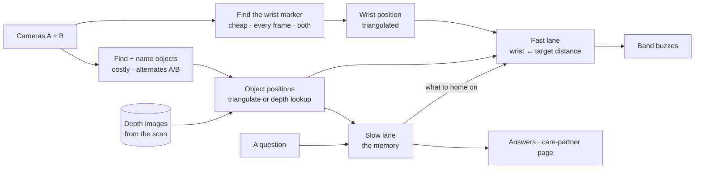

# Recall — system design

Two webcams cover a room. A one-time phone scan gives them a 3D map of the room's fixed
surfaces. The cameras keep a running memory of where each object is in that map. A band on
the wrist buzzes faster as the hand gets closer to the one you asked for.

Product context, scope and demo: [PLAN.md](./PLAN.md).

**Four things to take away:**

1. **The map and the memory are different layers** (§2). The map is the room's fixed
   surfaces, scanned once. The memory is where the objects are. Objects move without a
   rescan.
2. There are **two lanes through perception**, with different latencies and different
   standards of proof (§3). Most bugs in this system will come from mixing them.
3. **The band usually guides you to something the camera cannot see** — that's the whole
   product — so a question must be *resolved* to a visible proxy before it can be homed on
   (§5).
4. **The pulse carries certainty, not just distance.** An inferred answer can never buzz as
   hard as an observed one (§5.2).

Every number in §9 is a starting point to calibrate on the real rig, not a tuned constant.

---

## 1. Setup (once)

Done by the care partner, never the person living there. About ten minutes.

1. **Put one printed tag** (`printables/setup_tag.pdf`: ArUco `DICT_4X4_50` id 0, 18cm) on
   the floor in the middle of the room, where both cameras can see it. **Tape its outline.**
2. **Clear small objects off the surfaces and scan the room** with a LiDAR iPhone and an
   existing scan app. The tag is in the scan.
3. **Find the tag in the scan** (§1.1).
4. **Each camera finds the tag** and works out where it is in the map (§1.2).
5. **Turn the scan into one depth image per camera** (§1.3).
6. **Remove the tag.**
7. **Name the surfaces** (§6.1) and **list the objects** by name.

**One tag is enough.** It's the one thing both the scan and the cameras see, so it ties
their coordinates together. Two rules: it must not move between steps 2 and 4, and both
cameras must see it. If a camera is bumped later, put the tag back on its outline and redo
steps 4–5 for that camera. No rescan.

### 1.1 Finding the tag in the scan

The LiDAR measures depth; it can't read the tag. The phone's colour camera can, and the scan
app uses those images as the mesh's texture — so the tag shows up on the mesh.

Open the textured mesh in Blender or MeshLab and click the tag's four corners. That gives
`tag_in_map`, accurate to about 1cm. If that turns out not to be enough, export the scan
app's raw frames and per-frame phone positions and detect the tag in them instead.

### 1.2 Registering the cameras

```python
T_cam_tag = solvePnP(tag corners in this camera)    # where the tag is, seen from this camera
T_map_cam = tag_in_map @ inv(T_cam_tag)             # where this camera is, in the map
```

Each webcam needs its lens measured first (`K`, distortion): show it the ChArUco board
(`printables/calibration_board.pdf`) ~20 times. Once per webcam, ~10 minutes.

**Watch the axes.** ARKit cameras are y-up, looking down −z. OpenCV cameras are y-down,
looking down +z. Convert with `diag(1, −1, −1)`. Getting this wrong mirrors the world without
an error.

### 1.3 Depth images

Render the scan from each camera's position: for every pixel, the distance to the fixed
room behind it. Save it as one array per camera. **At runtime, the mesh is never loaded** —
depth is an array lookup.

Pixels the scan missed (glass, mirrors, places the phone didn't point) have no depth.

### 1.4 Check it

Pick two points on a table, compare their distance in the map to a tape measure. A 1° error
is ~9cm at 5m. Off by more than a few cm → check the axes first.

---

## 2. Map and memory

| | Map | Memory |
|---|---|---|
| **Is** | The scan, as a depth image per camera | Per object: position, surface, status, time, photo |
| **Changes** | Only when furniture moves | Every confirmed move |
| **Used for** | Depth for objects one camera sees (§4.1) | Answers, guidance, the care-partner page |

**Small objects are never in the map.** When the keys move, the next sighting looks up depth
in the unchanged map and updates one row of the memory.

**The map goes stale only when furniture moves.** Then: tag back on its outline, rescan, redo
setup. Bags and baskets are listed as *objects*, not part of the map, so they never cause this.

---

## 3. The two lanes



| | Fast lane | Slow lane |
|---|---|---|
| **Question it answers** | How close is the hand to the thing? | What is where, and did it move? |
| **Serves** | The band | Answers, history, the page |
| **Latency** | Instant, or it feels broken | Seconds are fine |
| **Noise** | Smoothed and tolerated | Rejected before anything is committed |
| **Persistence** | None — last value wins | Append-only and durable |
| **A wrong value costs** | A momentary jittery buzz | A corrupt memory and a lost answer |

**Driving the band off the committed memory is the obvious mistake and it will feel
awful.** The memory is slow to be convinced on purpose; the band must not be.

**One thing crosses, in one direction:** a question tells the fast lane *what to home on*.

**Everything is in map coordinates,** so the wrist can be in camera A's view while the target
is in camera B's.

**Two costs, two rates.** Finding the marker is a colour threshold — a few ms, every frame,
both cameras. Finding objects is a neural net at ~20–70ms, alternating cameras. Objects sit
still; the hand is the part that moves, and it's the cheap half.

---

## 4. Positions in the map

### 4.1 Objects

The detector is YOLO-World, given the object names ("keys", "wallet", "blue bag"). **The
name is the identity** — "keys" in camera A and "keys" in camera B are the same keys.

| Seen by | Position from |
|---|---|
| **Both cameras** | **Triangulate** the box centres. Reject if reprojection error > `TRI_MAX_PX` |
| **One camera** | **Depth lookup** at the box's **bottom-centre** — where the object touches the surface |
| **Neither** | No position this frame. The memory keeps the last one (§8) |

Use the bottom-centre, not the middle: the middle of a tall object lines up with the wall
behind it, not the surface it's on. No depth at that pixel → no position.

### 4.2 The wrist

The band carries a **magenta marker**. Both cameras find it and **triangulate** it.

**Never use the depth image for the wrist.** The hand wasn't in the scan, so the depth
behind it is the couch or the floor, not the hand.

Seen by only one camera → treated as lost (§11).

---

## 5. Guiding to something the camera can't see

The glasses go into a bag. They now have no position in any frame. "Where are my glasses"
must resolve to something that *does* have one.

### 5.1 The resolution chain

Asking runs this once and sets a **guide target** and a **ceiling** on the fast lane.

```
ask("glasses") ──> WorldState["glasses"]
   │
   ├─ status = observed
   │     guide target = the glasses themselves        ceiling 1.00
   │     say: "on the kitchen counter"
   │
   ├─ status = inferred_contained(bag)
   │     resolve the container, recursively
   │     ├─ container observed
   │     │     guide target = the bag                  ceiling 0.75
   │     │     say: "in the blue bag, on the counter — inferred"
   │     └─ container also missing → fall through ↓
   │
   ├─ last known position exists
   │     guide target = a fixed point in the map       ceiling 0.50
   │     say: "last seen on the counter at 2:40. I haven't seen it since."
   │
   └─ no record at all
         no target; band stays silent
         say: "I don't have a record of that."
```

**The guide target is an object, not a coordinate.** The fast lane reads its live position.
If someone carries the bag to the hallway, the target goes with it.

### 5.2 The ceiling: certainty you can feel

| Status | Ceiling | What the hand feels at the target |
|---|---|---|
| Observed | 1.00 | Full, fast, unmistakable |
| Inferred through a container | 0.75 | Clearly strong, but noticeably gentler |
| Last-known position only | 0.50 | A soft, slow pulse even standing right over it |

The voice says "observed" and "inferred"; without a ceiling the band would buzz as hard over
a guess as over a fact. One multiply.

### 5.3 Ending the guidance

Whichever comes first:

- **Found it** — distance below `FOUND_AT` held for `FOUND_HOLD`: **double-pulse**, then
  silence.
- **A new question** — replaces the target.
- **Timeout** — `TARGET_TTL` with no progress.

---

## 6. Components

| Component | Owns | Does not own |
|---|---|---|
| **Setup script** | Lens calibration, tag-in-map, camera registration, depth images, surfaces, object list | Anything at runtime |
| **Camera threads** | Frame grab per camera, both at once; ring buffer for photos | Interpretation |
| **Perception** | YOLO-World with the object names → named boxes, per camera | Whether a change is real |
| **Localizer** | Triangulate or depth lookup → object positions (§4.1) | Memory |
| **Wrist tracker** | Magenta threshold → triangulated wrist position (§4.2) | Objects |
| **Change detection** | §8, including the containment guess | Storage format |
| **Store** | Append-only log, current state, atomic writes, photos | Query semantics |
| **Query** | Band button → record → speech-to-text → object name | Answers |
| **Target resolver** | §5: object name → guide target + ceiling + answer text | Geometry |
| **Proximity service** | Wrist ↔ target distance → one byte, at frame rate | Anything durable |
| **Band firmware** | Button press out. One byte in → servo rate. Double-pulse on `0xFF` | Sensing, deciding |
| **Care-partner page** | Polling `/state` and `/changes`, rendering them | Any write path |

### 6.1 Surfaces

Named regions of the map — "kitchen counter", "sofa". At setup, drag a rectangle on a
top-down view of the scan and name it. `surface_at(xyz)` is a point-in-box test. This is
what lets the answer use the household's words.

---

## 7. The seams

```python
CameraPose  = {cam, K, dist, T_map_cam, depth_path}
Sighting    = {cam, object, bbox, score, ts}               # object = its name
Position    = {object, xyz, method, ts}                    # method: triangulated | depth
Transition  = {object, kind, from_surface, to_surface, from_xyz, to_xyz,
               ts, photo_path, confidence}
              # kind: moved | appeared | disappeared | inferred_contained
WorldState  = {object: {xyz, surface, status, confidence, since, last_observed,
                        container?, last_cam, last_bbox}}
              # status: observed | inferred | unknown
Surface     = {name, box_min, box_max}
Wrist       = {xyz, ts}
GuideTarget = {kind, object?, xyz?, ceiling, set_at}       # kind: object | point | none
Proximity   = {target, distance_m, closeness, ceiling, ts}
Answer      = {text, status, confidence, photo_path}
```

All `xyz` are metres in the map. `cam` and `bbox` survive only where pixels matter:
containment (§8) and photos. Setup writes `rig.json`: the `CameraPose`s, `Surface`s and
object names. The runtime only reads it.

**BLE, laptop → band: one byte.** `0..254` is `closeness × ceiling × 254`; `255` is the
found-it double-pulse.

```c
if (b == 255) { double_pulse(); return; }
interval_ms = lerp(PULSE_FAR, PULSE_NEAR, b / 254.0);
```

**BLE, band → laptop: button presses.** First tap starts recording, second tap stops it.

**HTTP, in full. Anything not here is out of scope:**

```
GET  /state                -> WorldState
GET  /changes?since=today  -> [Transition]      # care-partner page
POST /ask      {text}      -> Answer            # also sets the GuideTarget
GET  /proximity            -> Proximity         # on-screen meter
GET  /stream/{cam}         -> MJPEG             # setup and demo view
```

---

## 8. Change detection

Every capture, for each listed object:

```python
for obj in objects:
    pos = localize(obj, cameras)                # §4.1: triangulate, else depth lookup, else None

    if pos:
        obj.misses = 0
        if dist(pos.xyz, obj.xyz) > MOVE_MIN:   # it moved
            commit(obj, pos.xyz, surface_at(pos.xyz), photo=frame)
        obj.status = "observed"

    else:
        obj.misses += 1
        if obj.misses < MISSING_AFTER_K:
            continue                            # not gone, just blinked

        # gone. look at the last picture it was in, and ask what it went into.
        container = most_overlapping(obj.last_bbox, obj.last_frame_sightings,
                                     exclude=["person"])
        if container:
            obj.status, obj.container = "inferred", container
        else:
            obj.status = "unknown"
        commit_disappearance(obj, photo=obj.last_frame)
```

Containment is a 2D question — "what was it on top of in that picture" — so it stays in the
pixels of the camera that last saw the object.

**Two guards:**

1. **`MISSING_AFTER_K`** — a hand passing over the surface hides objects for a frame.
2. **`exclude=["person"]`** — a hand over an object is the most common false containment.

**Containers must be on the object list**, or `most_overlapping` has nothing to return.

---

## 9. Parameters

Starting points, to calibrate on the rig.

| Name | Start | Notes |
|---|---|---|
| `CAPTURE` | 1920×1080 per camera | Small objects need the pixels at room scale |
| `DETECT_IMGSZ` | 1280 | 640 loses small objects past ~2m. Measure with `scripts/range_test.py` |
| `DETECT_HZ` | ~2–5 per camera, alternating | |
| `MARKER_HZ` | every frame (~30), both cameras | |
| `MARKER_HSV` | H 145–165, S > 120, V > 80 | Magenta. **Not** on wood, skin, or any prop |
| `MARKER_MIN_AREA` | 150 px | Rejects speckle |
| `SETUP_TAG` | 18cm, ArUco `DICT_4X4_50` id 0 | Use the size measured off the print |
| `TRI_MAX_PX` | 8 px | Reprojection error to accept a triangulation |
| `MOVE_MIN` | 0.10m | Smaller shifts aren't moves |
| `D_FAR` | 3.0m | `closeness = 1 − clamp(distance / D_FAR)` |
| `EMA_ALPHA` | 0.30 @ 30 Hz | ≈100ms time constant |
| `PULSE_FAR` / `PULSE_NEAR` | 1000ms / 150ms | Servo-limited. A coin motor allows ~80ms |
| `CEILING` | 1.00 / 0.75 / 0.50 | Observed / inferred / last-known (§5.2) |
| `FOUND_AT` / `FOUND_HOLD` | 0.20m / 1.5s | The marker sits ~15cm behind the fingertips |
| `TARGET_TTL` | 90s | |
| `MISSING_AFTER_K` | 3 captures | Then the containment guess |
| `CONTAIN_OVERLAP` | ≥ 0.25 IoU | At the last frame the object was present |

### 9.1 Compute budget

| Work | Cost | Rate |
|---|---|---|
| Frame grab, ×2 | ~5ms each | 30 Hz |
| Marker threshold + contour, ×2 | ~3–5ms each | every frame |
| Triangulate wrist, distance, EMA, ceiling | <1ms | every frame |
| **YOLO-World s, on the Mac's GPU** | **~21ms @ 640, ~66ms @ 1280** (measured) | alternating cameras |
| Depth lookup | free | per detection |

**Fast-lane latency:** grab 5ms → marker 5ms → arithmetic 1ms → BLE 10–20ms → servo ≈
**40ms**, under the ~150ms where lag becomes noticeable. The servo can't show changes faster
than a few Hz, so updating closeness above ~15 Hz is wasted.

**Two rules:**

1. **Perception never blocks the fast lane.** It runs on its own thread; the fast lane reads
   the latest positions it published.
2. **Throttle the BLE write.** Only when the byte changes by ≥2, at most ~15 Hz.

**If it's slow:** `DETECT_IMGSZ` 960, then 2 Hz per camera, then CoreML.

---

## 10. Process topology

One Python process. **One uvicorn worker** — two silently corrupt state. A camera thread per
camera, grabbing in sync; the fast lane runs in the capture loop; perception on its own
thread; BLE in a small asyncio task so a dropped link can't stall anything. The page polls.
No websockets.

---

## 11. Failure modes

### Build and demo

| Component | How it fails | Mitigation |
|---|---|---|
| Setup | Axes wrong; world mirrored | Tape-measure check (§1.4) before anything else |
| Setup | Camera bumped | Tag back on its outline, redo §1 steps 4–5 for that camera |
| Setup | Tag corners clicked imprecisely | Bigger tag; raw-frame detection (§1.1) |
| Map | Furniture moved since the scan | Rescan (§2) |
| Perception | Small objects missed at range | `range_test.py` early; bigger props; `DETECT_IMGSZ` 1280 |
| Perception | YOLO-World confuses two props | Props with clearly different names and looks |
| Marker | Lighting shifts the colour | Check magenta under demo lighting |
| Containment | A hand reads as containment | §8 guards |
| BLE | Pairing drops | BLE direct from the laptop, never venue wifi |
| Band | Flat battery; servo too slow to feel | Spare battery; swap to a coin motor |
| Voice | Noise, slurred speech | Typed query on screen |
| Store | Crash mid-write | Write a temp file, then rename |

### Runtime

**The rule: a stale buzz is a lie.** Silence has to mean "I've lost track."

| Event | Behaviour |
|---|---|
| **Wrist lost** (hidden, or only one camera sees it) | Hold the last closeness ~1s, then **fade to zero**. Never freeze a strong buzz |
| **Guide target lost** | Re-run §5's chain — usually a lower rung and a gentler pulse |
| **One camera disconnects** | Objects fall back to depth lookup; the wrist is lost, so the band goes quiet. Voice keeps working |
| **Both cameras disconnect** | Freeze state, answers stamped "as of ⟨time⟩", band silent |
| **BLE drops** | Auto-reconnect; the on-screen meter keeps working |
| **Two markers in view** | Take the larger and log it |

---

## 12. Parallel work plan

- **A — space:** lens calibration, scan import, tag-in-map, registration, depth images,
  surfaces, localizer. Owns `CameraPose`, `Position`, `Surface`.
- **B — memory and answers:** perception, change detection, containment, store, query,
  resolver, answers, care-partner page. Owns `Sighting`, `Transition`, `WorldState`,
  `GuideTarget`, `Answer`.
- **C — the band:** wrist tracker, proximity, on-screen meter, BLE, firmware. Owns `Wrist`,
  `Proximity`.

**Nobody waits.** C starts with one camera, measuring closeness in pixels against a hardcoded
target, and swaps in real positions when A lands. B works against hand-written `Position`
fixtures. A works against a recorded scan and saved frames.

**The integration that will hurt** is §5's resolver, where all three meet. Build it against
fake `WorldState` fixtures for observed, inferred, last-known and unknown before real state
exists.

---

## 13. Open questions

- **Where does the mic live?** On the band (audio over BLE is tight) or on the laptop, turned
  on by the band's button (simple). Recommend the laptop for the demo.
- **Servo or coin motor?** The servo is the stand-in. Swap if the near end feels flat.
- **Can the detector see the props across the room?** `scripts/range_test.py` at 1–5m, at 640
  and 1280. The answer sets camera placement and `DETECT_IMGSZ`.
- **Do both cameras see the wrist often enough?** If the couch or the body blocks one camera
  a lot, add a printed tag to the band so one camera can locate it alone.
- **Is clicking the tag's corners accurate enough?** The tape measure decides.
- **Camera placement.** Opposite high corners, both seeing the middle of the room.
- **Do the ceilings read as "less sure" through a sleeve?** 0.75 and 0.50 are guesses.
- **How many objects before YOLO-World confuses them?** Five is the demo; beyond is
  unmeasured.
