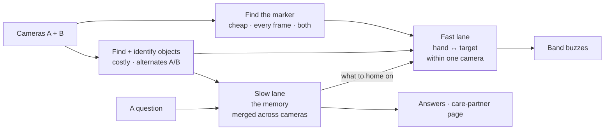

# Recall — system design

Two cameras watch a room and keep a running memory of the objects in it. A band on the
wrist buzzes faster as the hand gets closer to the one you asked for.

Product context, scope and demo: [NEWPLAN.md](./NEWPLAN.md).

**Three things to take away:**

1. There are **two lanes through perception**, with different latencies and different
   standards of proof (§1). Most bugs in this system will come from mixing them.
2. **The band usually guides you to something the camera cannot see** — that's the whole
   product — so a question must be *resolved* to a visible proxy before it can be homed on
   (§3).
3. **The pulse carries certainty, not just distance.** An inferred answer can never buzz as
   hard as an observed one (§3.2). The haptic channel tells the truth the same way the
   spoken one does.

Every number in §7 is a starting point to calibrate on the real rig, not a tuned constant.

---

## 1. The two lanes

Two cameras. Each frame looked at once. Two consumers that want opposite things.



| | Fast lane | Slow lane |
|---|---|---|
| **Question it answers** | How close is the hand to the thing? | What is where, and did it move? |
| **Serves** | The band | Answers, history, the page |
| **Latency** | Instant, or it feels broken | Seconds are fine |
| **Noise** | Smoothed and tolerated | Rejected before anything is committed |
| **Persistence** | None — last value wins | Append-only and durable |
| **A wrong value costs** | A momentary jittery buzz | A corrupt memory and a lost answer |

**Why the split is the design.** The memory is deliberately *slow to be convinced* — it
waits before committing that something moved, because a history full of phantom moves is
worthless, and because a system that declines to commit an uncertain observation is the
thing that makes it trustworthy. The band needs the opposite: immediate and
noise-tolerant, because a buzz lagging behind the wrist feels broken. **Driving the band
off the committed memory is the obvious mistake and it will feel awful.**

**One thing crosses, in one direction.** Asking a question is the only moment the slow lane
touches the fast one: it says *what to home on*. That is §3, and it is the hard part.

**Two different costs, which is why they run at different rates.** Finding the band's
marker is not object detection — it's a colour threshold and a contour, a few milliseconds,
cheap enough for every frame on both cameras. Finding the objects is a neural net at
~50–80ms, so it alternates between cameras and the fast lane reuses the last boxes in
between. That's fine: the hand is the thing that moves, and the hand is the cheap half.

### 1.1 Two cameras, and the one rule that keeps it simple

Each camera runs its own pass. The two lanes treat the second camera very differently:

- **The memory merges.** An object is *observed* if **any** camera sees it; take the
  sighting with the higher confidence. A straight win — something hidden from A is often
  visible to B, so there are fewer false disappearances and the room covers more than one
  surface.
- **The band does not merge.** Closeness is a pixel distance, and pixels from two cameras
  aren't comparable. So: **the band is driven by whichever camera currently sees both the
  wrist marker and the guide target.** If no single camera sees both, there is no proximity
  to report and the band falls to the next rung in §3 — a gentler pulse, or silence.

That rule is what preserves the no-calibration decision in §2. Two cameras would otherwise
force a shared coordinate frame, which means calibrating both, which is an hour of work
and a class of silent failure. **Guide within a camera; remember across both.**

It also matches the interaction: voice gets you to the right place, the band finds it once
you're there. Walking between the cameras' views is the voice half of the product.

---

## 2. Proximity without calibration

Warmer/colder needs a distance signal that is **monotonic**, not **metric**. For a fixed
target, as the hand moves closer in 3D the pixel separation between the wrist marker and
the target's box shrinks — every time, for any reasonable camera placement. Pulse rate is a
function of that pixel distance, normalised by the working area of the frame.

- **Ship:** closeness from **pixel distance**, normalised, EMA-smoothed.
- **Optional polish, only with spare time:** one homography per surface, to make the
  gradient feel linear rather than perspective-warped and to let an answer state a real
  distance. Nothing else depends on it.

No tape, no measuring, no scanner, no per-camera extrinsics. If the homography is ever
added, note that the wrist hovers *above* the surface plane, so the wrist point carries
parallax error the object points don't — another reason pixel space is the better trade.

---

## 3. Guiding to something the camera can't see

The glasses go into a bag. They now have no box in any frame. The band cannot home on
them — so "where are my glasses" must resolve into something that *does* have a box.

### 3.1 The resolution chain

Asking a question runs this once and sets two values on the fast lane: a **guide target**
and a **ceiling**.

```
ask("glasses") ──> WorldState["glasses"]
   │
   ├─ status = observed
   │     guide target = the glasses themselves        ceiling 1.00
   │     say: "on the kitchen counter"
   │
   ├─ status = inferred_contained(bag)
   │     resolve the container, recursively
   │     ├─ container observed
   │     │     guide target = the bag                  ceiling 0.75
   │     │     say: "in the blue bag, on the counter — inferred"
   │     └─ container also missing → fall through ↓
   │
   ├─ last known position exists
   │     guide target = a fixed pixel point            ceiling 0.50
   │     say: "last seen on the counter at 2:40. I haven't seen it since."
   │
   └─ no record at all
         no target; band stays silent
         say: "I don't have a record of that."
```

**The guide target is an object, not a box.** The resolver names *what* to home on; the
fast lane picks the camera that currently sees both it and the wrist, and takes the boxes
from there (§1.1). If no camera sees both, the band drops a rung and softens — the correct
signal, not a failure.

**The chain is recursive and follows movement.** Glasses in the bag, bag on the counter →
guide to the bag. If someone carries the bag to the hallway, the guide target goes with it,
because it is the bag's live box and not a stored coordinate.

### 3.2 The ceiling: certainty you can feel

The ceiling caps the maximum pulse rate the band can reach, regardless of distance.

| Status | Ceiling | What the hand feels at the target |
|---|---|---|
| Observed | 1.00 | Full, fast, unmistakable |
| Inferred through a container | 0.75 | Clearly strong, but noticeably gentler |
| Last-known position only | 0.50 | A soft, slow pulse even standing right over it |

The product's core promise is that it never confidently lies. The voice honours that with
"observed" and "inferred." Without a ceiling the *band* would break it — buzzing just as
hard over a guess as over a fact. A capped pulse says "I think, I don't know" in the
channel the person is actually using, and they learn the difference in two uses without
anyone explaining it. It costs one multiply on a value already computed.

### 3.3 Ending the guidance

A band that buzzes forever is worse than one that never buzzes. The target clears on
whichever comes first:

- **Found it** — closeness above `FOUND_AT` held for `FOUND_HOLD`: send a **distinct
  double-pulse**, then go silent. This is the termination condition, which is why the
  double-pulse is worth building rather than a nicety.
- **A new question** — the new target replaces the old.
- **Timeout** — `TARGET_TTL` with no progress.

---

## 4. Components

| Component | Owns | Does not own |
|---|---|---|
| **Camera threads** | Frame grab per camera, ring buffer for evidence stills, motion trigger | Any interpretation of a frame |
| **Perception** | One pass per camera: boxes **and** which enrolled object each one is. Detection and identity are one component — nothing consumes a box before it has an identity | Whether a change is real |
| **Marker tracker** | Finding the band: HSV threshold → largest blob → centroid, on both cameras | Anything about objects |
| **Zone map** | Named regions generated at onboarding (§4.1), and the point-in-region test | Metric position |
| **Change detection** | The if/else in §6, including the containment guess on disappearance | Storage format |
| **Store** | Append-only log, current state, atomic writes, stills on disk | Query semantics |
| **Target resolver** | §3's chain: question → guide target + ceiling + answer text | Pixel geometry |
| **Proximity service** | Pixel distance → closeness → one byte, at frame rate | Anything durable |
| **Band firmware** | One byte in → pulse interval out. Double-pulse on `0xFF` | Sensing, localising, deciding |
| **Care-partner page** | Polling two endpoints and rendering them | Any write path |

### 4.1 Zones come from onboarding

A one-time pass per camera, instead of hand-drawn polygons:

1. Point the camera at the room and run perception once on a still scene.
2. Keep the large, static detections — the furniture classes the detector already knows
   (table, counter, couch, chair, bed, sink, fridge). Each box becomes a candidate zone,
   already named by its class.
3. Show them as an overlay. The person **confirms, renames, or deletes** — "dining table"
   becomes "the kitchen counter" if that's what they call it.
4. Freeze and store per camera.

The zone ends up named by something the detector can actually see, so the phrase in the
answer and the region on screen can never drift apart. And a new room is a thirty-second
scan rather than a config file.

**The honest limit:** the detector's furniture vocabulary is fixed, and *kitchen counter*
isn't in it. Step 3 is not polish — it's the step that makes the vocabulary match the
household's words. If a surface is detected as nothing at all, let them drag one box. Keep
that fallback; it's twenty lines and covers every gap.

---

## 5. The seams

Agree on these and three people can work at once without blocking.

```python
Sighting    = {cam, object_id, bbox, score, ts}        # box + identity, one pass
Observation = {cam, object_id, bbox, zone, confidence, ts, frame_id}
Transition  = {object_id, kind, from_zone, to_zone, ts, still_path, confidence}
              # kind: moved | appeared | disappeared | inferred_contained
WorldState  = {object_id: {zone, status, confidence, since, last_observed,
                           container?, last_cam, last_bbox}}
              # status: observed | inferred | unknown
Zone        = {cam, name, box, source}                 # source: detected | manual
GuideTarget = {kind, object_id?, ceiling, set_at}      # kind: object | point | none
Proximity   = {cam, target_id, closeness, ceiling, ts} # cam = the one seeing both
Answer      = {text, status, confidence, still_path}
```

`cam` threads through everything pixel-space. `WorldState` is the only structure that is
camera-agnostic — it merges (§1.1), which is exactly why the band can't read it directly.
`last_bbox` exists only so the resolver can fall back to a point; it is a cache, never
evidence.

**BLE payload is one byte.** `0..254` is `closeness × ceiling × 254`; `255` is reserved for
the found-it double-pulse. The band does:

```c
if (b == 255) { double_pulse(); return; }
interval_ms = lerp(PULSE_FAR, PULSE_NEAR, b / 254.0);
```

and nothing else. The phone fallback and the on-screen meter consume the identical byte,
which is what makes the fallback ladder a drop-in rather than a rewrite.

**HTTP surface, in full. Anything not here is out of scope:**

```
GET  /state                     -> WorldState
GET  /objects/{id}/history      -> [Transition]
GET  /changes?since=today       -> [Transition]      # care-partner page
POST /ask        {text}         -> Answer            # also sets the GuideTarget
GET  /proximity                 -> Proximity         # meter + debugging
POST /enroll     {bbox, name}   -> reference crops + embedding
GET  /stream/{cam}              -> MJPEG             # onboarding, enrollment, demo view
```

---

## 6. Change detection

Every capture, for each enrolled object. This is the whole algorithm:

```python
for obj in enrolled:
    seen = best_sighting(obj, cameras)          # any camera, highest score

    if seen:
        obj.misses = 0
        zone = zone_at(seen.cam, seen.bbox)
        if zone != obj.zone:                    # it moved
            commit(obj, zone, still=frame)
        obj.status = "observed"

    else:
        obj.misses += 1
        if obj.misses < MISSING_AFTER_K:
            continue                            # not gone, just blinked

        # gone. look at the last picture it was in, and ask what it went into.
        container = most_overlapping(obj.last_bbox, obj.last_frame_sightings,
                                     exclude=["person"])
        if container:
            obj.status, obj.container = "inferred", container
        else:
            obj.status = "unknown"
        commit_disappearance(obj, still=obj.last_frame)
```

No state machine, no hysteresis schedule, no tuning beyond one overlap threshold. "Where
did it go?" is answered by looking at the picture from the moment before it vanished and
taking whatever it was most on top of.

**Two guards, and only two.** Both are one line, and both are things that break on camera
rather than complexity for its own sake:

1. **`MISSING_AFTER_K`** — don't call it gone on a single miss. A hand passing over the
   surface blanks half the objects for one frame; without this the display flickers and the
   log fills with phantom disappearances.
2. **`exclude=["person"]`** — a hand on top of an object is the most common false
   containment, and "your keys are inside your husband" is not an answer to ship.

**One rule that is not optional:** never promote `inferred` to `observed`. The status rides
all the way out to the answer text, the page, and the band's ceiling (§3.2).

**Containers must be enrolled too.** The bag needs its own identity, or `most_overlapping`
has nothing to return and §3's resolver has nothing to home on.

---

## 7. Parameters

Starting points, to calibrate on the rig.

| Name | Start | Notes |
|---|---|---|
| `CAPTURE` | 1280×720 per camera | |
| `MARKER_HZ` | every frame (~30), both cameras | HSV is ~2ms; the wrist is what moves |
| `DETECT_HZ` | ~5 per camera, alternating | Two cameras share one detector budget |
| `MARKER_HSV` | H 145–165, S > 120, V > 80 | Magenta. **Not** on wood, skin, or any prop |
| `MARKER_MIN_AREA` | 150 px | Rejects speckle |
| `D_REF` | working-area diagonal | `closeness = 1 − clamp(d_px / D_REF)` |
| `EMA_ALPHA` | 0.30 @ 30 Hz | ≈100ms time constant. Higher = jitterier, lower = laggy |
| `PULSE_FAR` / `PULSE_NEAR` | 900ms / 80ms | The felt range of the whole interaction |
| `CEILING` | 1.00 / 0.75 / 0.50 | Observed / inferred / last-known (§3.2) |
| `FOUND_AT` / `FOUND_HOLD` | 0.92 / 1.5s | Triggers the double-pulse and ends guidance |
| `TARGET_TTL` | 90s | A band that buzzes forever is worse than one that doesn't |
| `REID_ACCEPT` | ≥ 0.80 cosine | Commit |
| `REID_UNCONFIRMED` | 0.60–0.80 | Hold, commit nothing |
| `MISSING_AFTER_K` | 3 captures | Then make the containment guess |
| `CONTAIN_OVERLAP` | ≥ 0.25 IoU | At the last frame the object was present |

### 7.1 Compute budget

The part that runs every frame isn't the expensive part.

| Work | Cost | Rate |
|---|---|---|
| Frame grab, ×2 | ~5ms each | 30 Hz |
| **Marker: `cvtColor` → `inRange` → `findContours`, ×2** | **~3–5ms each at 720p, <1ms at half scale** | **every frame, both** |
| Distance + EMA + ceiling | <1ms | every frame |
| **Perception: boxes + identity** | **~50–80ms per pass** | **alternating, ~5 Hz each** |
| Re-id embeddings | ~50–100ms per batch | capture burst only, never in the loop |

**The bound that makes this easy:** the fastest pulse is `PULSE_NEAR` = 80ms, i.e. 12.5 Hz.
You cannot express a change faster than the pulse rate, so **updating closeness above
~15 Hz is wasted work.** The fast lane needs 15 Hz, not 30 — which a colour threshold
clears with an order of magnitude to spare.

**The second camera is nearly free in the fast lane and would double the slow lane**, so
perception **alternates** — A, B, A, B — giving each camera ~5 Hz. Targets sit still, so
that is plenty, and total detector load is identical to a one-camera design.

**Latency, fast lane:** grab 5ms → marker 2ms → arithmetic <1ms → BLE write 10–20ms → band
reaction <5ms ≈ **35ms**, well under the ~150ms feel threshold.

**Two rules that keep it true:**

1. **Perception must not block the fast lane.** Run it on its own thread against the latest
   frame; the fast lane reads the most recent boxes it published. Inline, a single 50ms
   call stalls the 2ms marker loop and the buzz visibly stutters.
2. **Throttle the BLE write.** Don't push at frame rate — write only when the byte moves by
   ≥2, capped around 15 Hz. Flooding the link adds latency instead of removing it.

**If it's slow on the real machine**, in order of leverage: shrink perception's input (416
or 320 instead of 640 — the props are large in frame, so this costs little and buys ~2–4×),
drop to 3 Hz per camera, run marker tracking at half scale, export the model to CoreML to
get off the CPU.

**Measure before trusting any of it:**

```bash
python -c "
from ultralytics import YOLO; import time, numpy as np
m, f = YOLO('yolo11n.pt'), np.zeros((720,1280,3), 'uint8')
m(f, verbose=False)                                    # warm up
t=time.time(); [m(f, imgsz=640, verbose=False) for _ in range(20)]
print('perception', (time.time()-t)/20*1000, 'ms')
"
```

Well under 100ms and the design holds as written.

---

## 8. Process topology

One Python process. **One uvicorn worker** — two silently corrupts state; put that in the
run script with a comment. A camera thread per camera owns capture; the fast lane runs
inline in that loop; the slow lane runs on trigger. BLE writes go out from a small asyncio
task so a dropped link can't stall perception. The frontend polls. No websockets.

**Enrollment** happens before any of this: hold the object in the reticle or pick its
detection off the stream, store 3–5 reference crops and their embeddings. Re-enroll **in
demo lighting at the demo camera positions** — the step most often skipped and most often
fatal.

---

## 9. Failure modes

### Build and demo

| Component | How it fails | Mitigation |
|---|---|---|
| Marker tracker | Lighting shifts the hue; something in frame shares the colour | Magenta, verified under demo lighting. Two-minute fix early, fatal late |
| Perception | Two similar dark objects swap identity | Curate visually distinct props. Cheapest high-leverage fix in the project |
| Containment | A hand over an object reads as containment | The two guards in §6 |
| Change detection | `MISSING_AFTER_K` too high → moves take too long to appear | Tune against the real capture cadence |
| BLE | Captive portals, pairing drops | BLE direct from the laptop, never venue wifi. Fallbacks rehearsed |
| Band | Flat battery | Charge the spare. The voice half keeps working |
| Voice | Noise; slurred or accented speech | Typed query path on screen, one click away |
| Store | Crash mid-write | Write to temp, then rename. The log is append-only |

### Runtime

**The governing rule: a stale buzz is a lie.** The haptic channel has no way to say "I've
lost track," so silence has to mean it.

| Event | Behaviour |
|---|---|
| **Marker lost** (hand out of frame, occluded) | Hold the last closeness ~1s, then **fade the pulse to zero and stop**. Never freeze a strong buzz |
| **Guide target lost** | Re-run §3's chain. Usually a drop to the next rung and a lower ceiling — the pulse gets gentler by itself, which is the correct signal |
| **Wrist and target in different cameras** | No proximity exists. Drop a rung and soften — the normal state while walking between views, not an error |
| **One camera disconnects** | The other carries on; the memory degrades gracefully because it merges. Guidance works wherever the survivor sees both |
| **Both cameras disconnect** | Freeze state, stamp answers "as of ⟨time⟩", band silent. Never answer from a frozen world as if it were live |
| **BLE drops** | Auto-reconnect in the background; the on-screen meter keeps working throughout |
| **Two markers in frame** | Take the larger blob and log it. Single-occupant is the real product; at a crowded table, only one band is powered on |

---

## 10. Parallel work plan

The seams in §5 let this run three-wide once the camera loop exists:

- **A — perception:** camera threads, detection + identity, enrollment, onboarding zones.
  Owns `Sighting`, `Observation`, `Zone`.
- **B — memory and answers:** change detection, containment, store, target resolver,
  templated answers, care-partner page. Owns `Transition`, `WorldState`, `GuideTarget`,
  `Answer`.
- **C — the band:** marker tracker, proximity service, on-screen meter, BLE, firmware.
  Owns `Proximity`.

**Nobody waits.** C starts on the meter against a stubbed centroid and a hardcoded target.
B develops against hand-written `Observation` fixtures. The first integration is A→B; the
second is B→C, and it is one struct wide.

**The integration that will hurt** is §3's resolver, the only place all three meet. Build
it against fake `WorldState` fixtures covering all four branches — observed, inferred,
last-known, unknown — before the real state exists.

---

## 11. Open questions

- **Where does the second camera point?** Two angles on one surface buys occlusion
  resilience and makes the band work from more positions. Two different surfaces buys the
  "voice gets you to the room, band finds it there" story. The second is the better pitch;
  the first is the safer demo.
- **Does onboarding's furniture detection find anything nameable in the real room?** Run it
  once, early. If it returns nothing, the manual-box fallback becomes the path, and that
  should be known on day one rather than at the table.
- **Marker form.** A ring of coloured tape around the strap, or a printed tag on top? Tape
  survives rotation; a tag is more reliably one blob. Decide with the camera on.
- **Idle behaviour.** With no question asked, the band stays silent. Homing on the most
  recently moved object is a better story and a worse demo.
- **Do the ceilings read as "less sure" through a sleeve?** 0.75 and 0.50 are guesses. Try
  them on a wrist before committing.
- **How many objects before identity degrades?** Five is the demo; beyond that is
  unmeasured. An honest "we don't know past five" is a fine answer.
