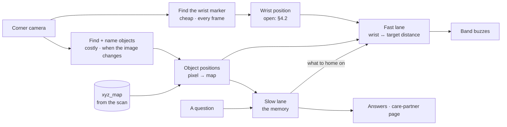

# Recall — system design

One webcam, high in a corner, watches a room. A one-time phone scan gives it a 3D map of the
room's fixed surfaces. The camera keeps a running memory of where each object is in that map.
A band on the wrist buzzes faster as the hand gets closer to the one you asked for.

Product context, scope and demo: [PLAN.md](./PLAN.md). The camera pipeline as built:
[CAMERA.md](./CAMERA.md). The room files between setup and the live loop:
[handoffAB.md](./handoffAB.md).

**Four things to take away:**

1. **The map and the memory are different layers** (§2). The map is the room's fixed
   surfaces, scanned once. The memory is where the objects are. Objects move without a
   rescan.
2. There are **two lanes through perception**, with different latencies and different
   standards of proof (§3). Most bugs in this system will come from mixing them.
3. **The band usually guides you to something the camera cannot see** — that's the whole
   product — so a question must be *resolved* to a visible proxy before it can be homed on
   (§5).
4. **The pulse carries certainty, not just distance.** An inferred answer can never buzz as
   hard as an observed one (§5.2).

Every number in §9 is a starting point to calibrate on the real rig, not a tuned constant.

---

## 1. Setup (once)

Done by the care partner, never the person living there. Three things by hand, then one command.

1. **Put up markers** (`printables/markers.pdf`, ArUco `DICT_4X4_50` ids 0–5): at least 3 where
   the webcam sees them face-on, on the floor **and** a wall it faces. They stay up. A marker on
   the wall the webcam hangs on is seen edge-on and missed; one under glass isn't seen at all.
2. **Scan** with a LiDAR iPhone in Polycam: **LiDAR mode**, Developer mode on before scanning.
   One slow loop ending where it started, passing within ~1m of each marker. Export **Raw data**
   (and **glTF** if the raw zip has no mesh) and drop the zip(s) into `data/room/`.
3. **Webcam in its final spot**, at 1280×720.
4. **`uv run tools/setup_room.py --camera brio`**

That writes `data/room/` (handoffAB.md). The first time it meets a webcam it opens a guided
lens calibration: hold the board (`printables/calibration_board.pdf`) 40–60cm away until the
on-screen grid fills; it finishes by itself and is saved in `data/cameras/` for every later room.

**Camera bumped:** re-run the command. **New scan:** drop the new zips in and re-run.

### 1.1 What the command does

1. **Scan** (`scan_to_room.py`). Polycam's raw export has every keyframe image with the phone's
   pose and LiDAR depth, in the mesh's coordinates.
   - **Checks the export lines up:** mesh depth against LiDAR depth for every way of reading
     Polycam's poses; keeps the one under 2cm.
   - **Finds the markers** in every keyframe and casts each corner onto the mesh (median over
     sightings), so markers and mesh share coordinates by construction. Their size comes from
     the scan.
   - **World frame, no clicks:** floor at y = 0 (the lowest broad flat surface), X and Z along
     the walls (from the walls' orientation), origin at the corner of the floor's outline.
   - **Writes** `room.glb`, `markers.json`, `plan.png` (top-down, with the axes), `scan_report.json`.
2. **Lens** (`calibrate_intrinsics.py`): reused from `data/cameras/`, or calibrated once.
3. **Webcam position** (`register_camera.py`): the webcam watches the markers for 2s;
   `solvePnP` gives `R, t` (`X_cam = R·X_world + t`) and `camera_center = −Rᵀt`. Writes
   `camera.json`, `camera_ref.jpg` and `camera_overlay.jpg`, which draws the markers and the scan
   where that pose puts them: they should sit on the real ones.

**Watch the axes.** ARKit cameras are y-up, looking down −z; OpenCV's are y-down, looking down
+z (`diag(1, −1, −1)`). The depth check in step 1 catches a wrong reading.

**Accuracy** comes from the markers. With 3 in view and the scan's ~2–3cm marker drift, floor
positions are good to roughly 5–8cm; more markers in view and a single-loop scan tighten it.

---

## 2. Map and memory

| | Map | Memory |
|---|---|---|
| **Is** | The scan (`room.glb`), precomputed as the map point behind every camera pixel (`xyz_map.npy`) | Per object: position, surface, status, time, photo |
| **Changes** | Only when furniture moves | Every confirmed move |
| **Used for** | Positions from pixels (§4.1) | Answers, guidance, the care-partner page |

**Small objects are never in the map.** When the keys move, the next sighting looks up the map
point behind its pixel and updates one row of the memory.

**The map goes stale only when furniture moves.** Then rescan with the markers still up and
re-run §1 steps 4 and 6. Bags and baskets are listed as *objects*, not part of the map, so they never cause this.

---

## 3. The two lanes



| | Fast lane | Slow lane |
|---|---|---|
| **Question it answers** | How close is the hand to the thing? | What is where, and did it move? |
| **Serves** | The band | Answers, history, the page |
| **Latency** | Instant, or it feels broken | Seconds are fine |
| **Noise** | Smoothed and tolerated | Rejected before anything is committed |
| **Persistence** | None — last value wins | Append-only and durable |
| **A wrong value costs** | A momentary jittery buzz | A corrupt memory and a lost answer |

**Driving the band off the committed memory is the obvious mistake and it will feel
awful.** The memory is slow to be convinced on purpose; the band must not be.

**One thing crosses, in one direction:** a question tells the fast lane *what to home on*.

**Two costs, two rates.** Finding the marker is a colour threshold — a few ms, every frame.
Finding objects is a neural net at ~20–70ms, run when the image changes (CAMERA.md's change
gate). Objects sit still; the hand is the part that moves, and it's the cheap half.

---

## 4. Positions in the map

### 4.1 Objects

The detector is YOLO-World, given the object names ("keys", "wallet", "blue bag"). **The
name is the identity:** one best box per name per frame.

| Object | Position from |
|---|---|
| **On any scanned surface** | **`pixel_to_world`** at the box's **bottom-centre**: the map point behind that pixel |
| **On the floor** | **`floor_hit`**: the pixel's ray meets y = 0. Exact, no mesh needed |
| **Not seen** | No position this frame. The memory keeps the last one (§8) |

Use the bottom-centre, not the middle: the middle of a tall object lines up with the wall
behind it, not the surface it's on. No map point behind that pixel → no position.

### 4.2 The wrist

The band carries a **magenta marker**. **One camera can't triangulate it**, so this is open
(§13). The two candidates:

- **A printed tag on the band:** one camera gets its 3D position from the tag's known size.
  About 2.5m of range for a 5cm tag.
- **Closeness in the image:** project the target into the camera (`world_to_pixel`) and measure
  pixels to the marker. No 3D needed, as in the original design.

**Never use the map for the wrist.** The hand wasn't in the scan, so the map point behind it is
the couch or the floor, not the hand.

---

## 5. Guiding to something the camera can't see

The glasses go into a bag. They now have no position in any frame. "Where are my glasses"
must resolve to something that *does* have one.

### 5.1 The resolution chain

Asking runs this once and sets a **guide target** and a **ceiling** on the fast lane.

```
ask("glasses") ──> WorldState["glasses"]
   │
   ├─ status = observed
   │     guide target = the glasses themselves        ceiling 1.00
   │     say: "on the kitchen counter"
   │
   ├─ status = inferred_contained(bag)
   │     resolve the container, recursively
   │     ├─ container observed
   │     │     guide target = the bag                  ceiling 0.75
   │     │     say: "in the blue bag, on the counter — inferred"
   │     └─ container also missing → fall through ↓
   │
   ├─ last known position exists
   │     guide target = a fixed point in the map       ceiling 0.50
   │     say: "last seen on the counter at 2:40. I haven't seen it since."
   │
   └─ no record at all
         no target; band stays silent
         say: "I don't have a record of that."
```

**The guide target is an object, not a coordinate.** The fast lane reads its live position.
If someone carries the bag to the hallway, the target goes with it.

### 5.2 The ceiling: certainty you can feel

| Status | Ceiling | What the hand feels at the target |
|---|---|---|
| Observed | 1.00 | Full, fast, unmistakable |
| Inferred through a container | 0.75 | Clearly strong, but noticeably gentler |
| Last-known position only | 0.50 | A soft, slow pulse even standing right over it |

The voice says "observed" and "inferred"; without a ceiling the band would buzz as hard over
a guess as over a fact. One multiply.

### 5.3 Ending the guidance

Whichever comes first:

- **Found it** — distance below `FOUND_AT` held for `FOUND_HOLD`: **double-pulse**, then
  silence.
- **A new question** — replaces the target.
- **Timeout** — `TARGET_TTL` with no progress.

---

## 6. Components

| Component | Owns | Does not own |
|---|---|---|
| **Setup tools** (`tools/`) | Scan → map + markers, lens calibration, camera registration, acceptance checks | Anything at runtime |
| **Camera thread** | Frame grab; ring buffer for photos | Interpretation |
| **Perception** | YOLO-World with the object names → named boxes | Whether a change is real |
| **Localizer** | `pixel_to_world` / `floor_hit` → object positions (§4.1) | Memory |
| **Wrist tracker** | Magenta threshold → wrist position (§4.2, open) | Objects |
| **Change detection** | §8, including the containment guess | Storage format |
| **Store** | Append-only log, current state, atomic writes, photos | Query semantics |
| **Query** | Band button → record → speech-to-text → object name | Answers |
| **Target resolver** | §5: object name → guide target + ceiling + answer text | Geometry |
| **Proximity service** | Wrist ↔ target distance → one byte, at frame rate | Anything durable |
| **Band firmware** | Button press out. One byte in → servo rate. Double-pulse on `0xFF` | Sensing, deciding |
| **Care-partner page** | Polling `/state` and `/changes`, rendering them | Any write path |

### 6.1 Surfaces

Named regions of the map — "kitchen counter", "sofa". At setup, drag a rectangle on a
top-down view of the scan and name it. `surface_at(xyz)` is a point-in-box test. This is
what lets the answer use the household's words.

---

## 7. The seams

```python
CameraPose  = {width, height, K, dist, R, t, camera_center, rms_px, markers_used, registered_at}
Sighting    = {cam, object, bbox, score, ts}               # object = its name
Position    = {object, xyz, method, ts}                    # method: pixel_to_world | floor_hit
Transition  = {object, kind, from_surface, to_surface, from_xyz, to_xyz,
               ts, photo_path, confidence}
              # kind: moved | appeared | disappeared | inferred_contained
WorldState  = {object: {xyz, surface, status, confidence, since, last_observed,
                        container?, last_cam, last_bbox}}
              # status: observed | inferred | unknown
Surface     = {name, box_min, box_max}
Wrist       = {xyz, ts}
GuideTarget = {kind, object?, xyz?, ceiling, set_at}       # kind: object | point | none
Proximity   = {target, distance_m, closeness, ceiling, ts}
Answer      = {text, status, confidence, photo_path}
```

All `xyz` are metres in the map. `cam` and `bbox` survive only where pixels matter:
containment (§8) and photos. Setup writes `data/room/` (`CameraPose` is `camera.json`;
handoffAB.md) and the `Surface`s. The runtime only reads them.

**BLE, laptop → band: one byte.** `0..254` is `closeness × ceiling × 254`; `255` is the
found-it double-pulse.

```c
if (b == 255) { double_pulse(); return; }
interval_ms = lerp(PULSE_FAR, PULSE_NEAR, b / 254.0);
```

**BLE, band → laptop: button presses.** First tap starts recording, second tap stops it.

**HTTP, in full. Anything not here is out of scope:**

```
GET  /state                -> WorldState
GET  /changes?since=today  -> [Transition]      # care-partner page
POST /ask      {text}      -> Answer            # also sets the GuideTarget
GET  /proximity            -> Proximity         # on-screen meter
GET  /stream/{cam}         -> MJPEG             # setup and demo view
```

---

## 8. Change detection

Every capture, for each listed object:

```python
for obj in objects:
    pos = localize(obj, camera)                 # §4.1: the map point at the box's base, else None

    if pos:
        obj.misses = 0
        if dist(pos.xyz, obj.xyz) > MOVE_MIN:   # it moved
            commit(obj, pos.xyz, surface_at(pos.xyz), photo=frame)
        obj.status = "observed"

    else:
        obj.misses += 1
        if obj.misses < MISSING_AFTER_K:
            continue                            # not gone, just blinked

        # gone. look at the last picture it was in, and ask what it went into.
        container = most_overlapping(obj.last_bbox, obj.last_frame_sightings,
                                     exclude=["person"])
        if container:
            obj.status, obj.container = "inferred", container
        else:
            obj.status = "unknown"
        commit_disappearance(obj, photo=obj.last_frame)
```

Containment is a 2D question — "what was it on top of in that picture" — so it stays in the
pixels of the camera that last saw the object.

**Two guards:**

1. **`MISSING_AFTER_K`** — a hand passing over the surface hides objects for a frame.
2. **`exclude=["person"]`** — a hand over an object is the most common false containment.

**Containers must be on the object list**, or `most_overlapping` has nothing to return.

---

## 9. Parameters

Starting points, to calibrate on the rig.

| Name | Start | Notes |
|---|---|---|
| `CAPTURE` | 1280×720 | The lens calibration is only valid at this resolution (handoffAB.md) |
| `DETECT_IMGSZ` | 1280 | 640 loses small objects past ~2m. Measure with `scripts/range_test.py` |
| `DETECT_HZ` | ~1, when the image changes | CAMERA.md's change gate |
| `MARKER_HZ` | every frame (~30) | |
| `MARKER_HSV` | H 145–165, S > 120, V > 80 | Magenta. **Not** on wood, skin, or any prop |
| `MARKER_MIN_AREA` | 150 px | Rejects speckle |
| `MARKERS` | ≥ 3 in the webcam's view, ArUco `DICT_4X4_50` ids 0–5 | Floor and wall. Size is read from the scan |
| `MOVE_MIN` | 0.10m | Smaller shifts aren't moves |
| `D_FAR` | 3.0m | `closeness = 1 − clamp(distance / D_FAR)` |
| `EMA_ALPHA` | 0.30 @ 30 Hz | ≈100ms time constant |
| `PULSE_FAR` / `PULSE_NEAR` | 1000ms / 150ms | Servo-limited. A coin motor allows ~80ms |
| `CEILING` | 1.00 / 0.75 / 0.50 | Observed / inferred / last-known (§5.2) |
| `FOUND_AT` / `FOUND_HOLD` | 0.20m / 1.5s | The marker sits ~15cm behind the fingertips |
| `TARGET_TTL` | 90s | |
| `MISSING_AFTER_K` | 3 captures | Then the containment guess |
| `CONTAIN_OVERLAP` | ≥ 0.25 IoU | At the last frame the object was present |

### 9.1 Compute budget

| Work | Cost | Rate |
|---|---|---|
| Frame grab | ~5ms | 30 Hz |
| Marker threshold + contour | ~3–5ms | every frame |
| Wrist, distance, EMA, ceiling | <1ms | every frame |
| **YOLO-World s, on the Mac's GPU** | **~21ms @ 640, ~66ms @ 1280** (measured) | when the image changes |
| `pixel_to_world` lookup | free | per detection |

**Fast-lane latency:** grab 5ms → marker 5ms → arithmetic 1ms → BLE 10–20ms → servo ≈
**40ms**, under the ~150ms where lag becomes noticeable. The servo can't show changes faster
than a few Hz, so updating closeness above ~15 Hz is wasted.

**Two rules:**

1. **Perception never blocks the fast lane.** It runs on its own thread; the fast lane reads
   the latest positions it published.
2. **Throttle the BLE write.** Only when the byte changes by ≥2, at most ~15 Hz.

**If it's slow:** `DETECT_IMGSZ` 960, then a lower rate, then CoreML.

---

## 10. Process topology

One Python process. **One uvicorn worker** — two silently corrupt state. One camera thread;
the fast lane runs in the capture loop; perception on its own
thread; BLE in a small asyncio task so a dropped link can't stall anything. The page polls.
No websockets.

---

## 11. Failure modes

### Build and demo

| Component | How it fails | Mitigation |
|---|---|---|
| Setup | Axes wrong; world mirrored | `scan_to_room.py`'s depth check; the overlay looks wrong |
| Setup | Camera bumped | Re-run `setup_room.py`; the markers are still up |
| Setup | Polycam's export doesn't line up with its own LiDAR | Click marker corners on the mesh (CAMERA.md E3); last resort, our own ARKit app |
| Setup | A marker isn't detected by the camera | It's seen edge-on or too small: move it to a wall the camera faces, or closer |
| Map | Furniture moved since the scan | Rescan (§2) |
| Perception | Small objects missed at range | `range_test.py` early; bigger props; `DETECT_IMGSZ` 1280 |
| Perception | YOLO-World confuses two props | Props with clearly different names and looks |
| Marker | Lighting shifts the colour | Check magenta under demo lighting |
| Containment | A hand reads as containment | §8 guards |
| BLE | Pairing drops | BLE direct from the laptop, never venue wifi |
| Band | Flat battery; servo too slow to feel | Spare battery; swap to a coin motor |
| Voice | Noise, slurred speech | Typed query on screen |
| Store | Crash mid-write | Write a temp file, then rename |

### Runtime

**The rule: a stale buzz is a lie.** Silence has to mean "I've lost track."

| Event | Behaviour |
|---|---|
| **Wrist lost** (hidden, or out of view) | Hold the last closeness ~1s, then **fade to zero**. Never freeze a strong buzz |
| **Guide target lost** | Re-run §5's chain — usually a lower rung and a gentler pulse |
| **Camera disconnects** | Freeze state, answers stamped "as of ⟨time⟩", band silent. Voice keeps working |
| **BLE drops** | Auto-reconnect; the on-screen meter keeps working |
| **Two markers in view** | Take the larger and log it |

---

## 12. Parallel work plan

- **A — space:** `tools/`: scan → `room.glb` + `markers.json`, lens calibration, camera
  registration, acceptance checks. Owns `data/room/` (handoffAB.md); B turns it into
  `pixel_to_world` (CAMERA.md Part E).
- **B — memory and answers:** perception, change detection, containment, store, query,
  resolver, answers, care-partner page. Owns `Sighting`, `Transition`, `WorldState`,
  `GuideTarget`, `Answer`.
- **C — the band:** wrist tracker, proximity, on-screen meter, BLE, firmware. Owns `Wrist`,
  `Proximity`.

**Nobody waits.** C starts with one camera, measuring closeness in pixels against a hardcoded
target, and swaps in real positions when A lands. B works against hand-written `Position`
fixtures. A works against a recorded scan and saved frames.

**The integration that will hurt** is §5's resolver, where all three meet. Build it against
fake `WorldState` fixtures for observed, inferred, last-known and unknown before real state
exists.

---

## 13. Open questions

- **Where does the mic live?** On the band (audio over BLE is tight) or on the laptop, turned
  on by the band's button (simple). Recommend the laptop for the demo.
- **Servo or coin motor?** The servo is the stand-in. Swap if the near end feels flat.
- **Can the detector see the props across the room?** `scripts/range_test.py` at 1–5m, at 640
  and 1280. The answer sets camera placement and `DETECT_IMGSZ`.
- **How does one camera locate the wrist?** A tag on the band, or closeness in the image
  (§4.2). C decides; it gates the band.
- **Does Polycam's raw export line up?** `scan_to_room.py` step 2 answers it on the first real
  scan.
- **Camera placement.** High in a corner, facing the marker walls, every marker within ~4m and
  seen face-on.
- **Do the ceilings read as "less sure" through a sleeve?** 0.75 and 0.50 are guesses.
- **How many objects before YOLO-World confuses them?** Five is the demo; beyond is
  unmeasured.
